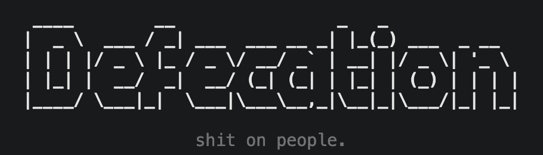
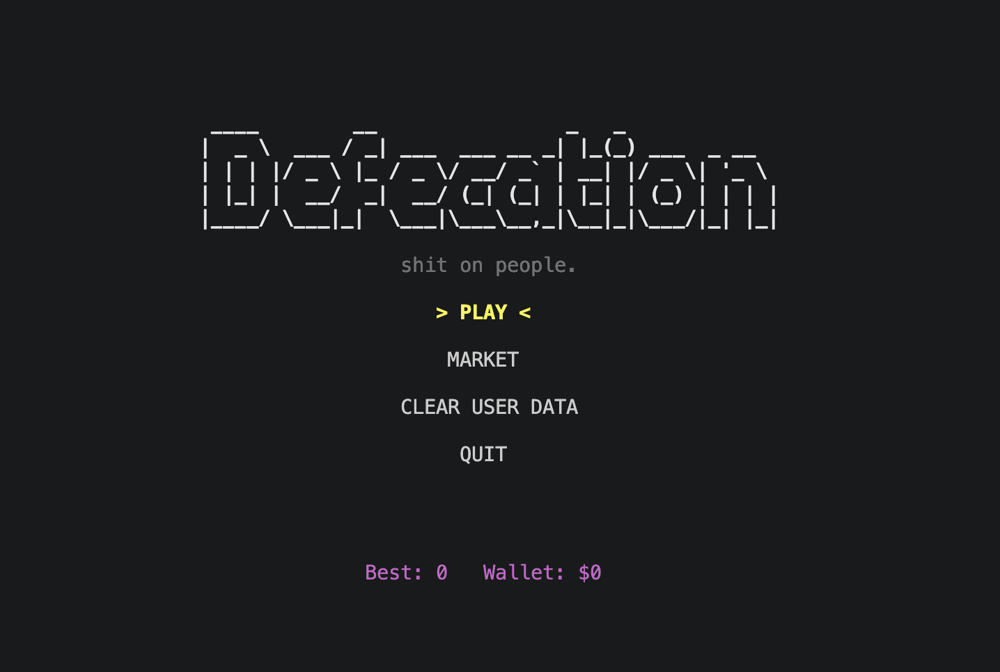
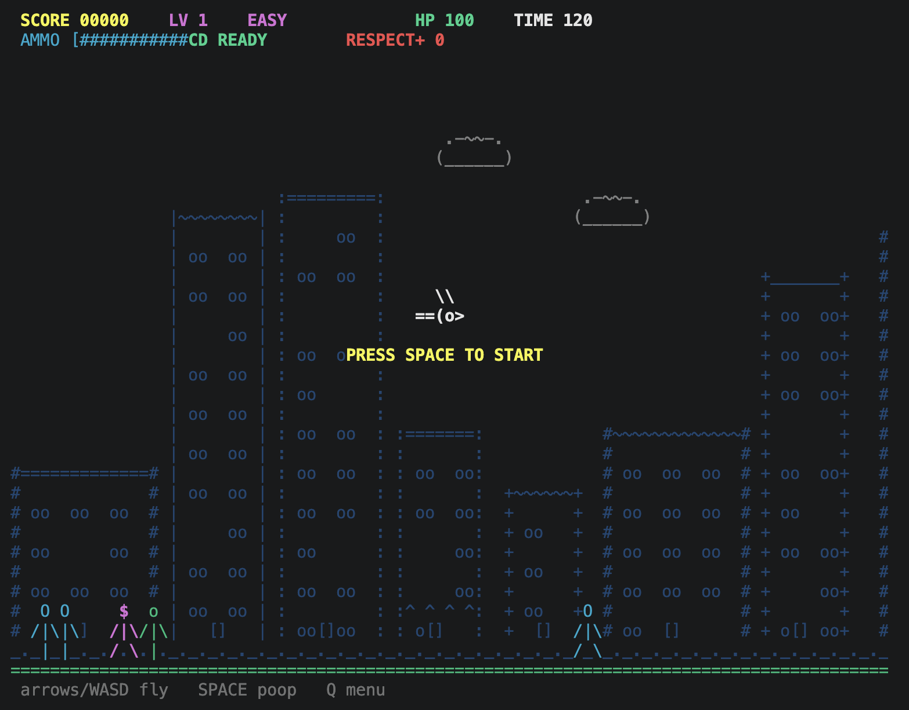
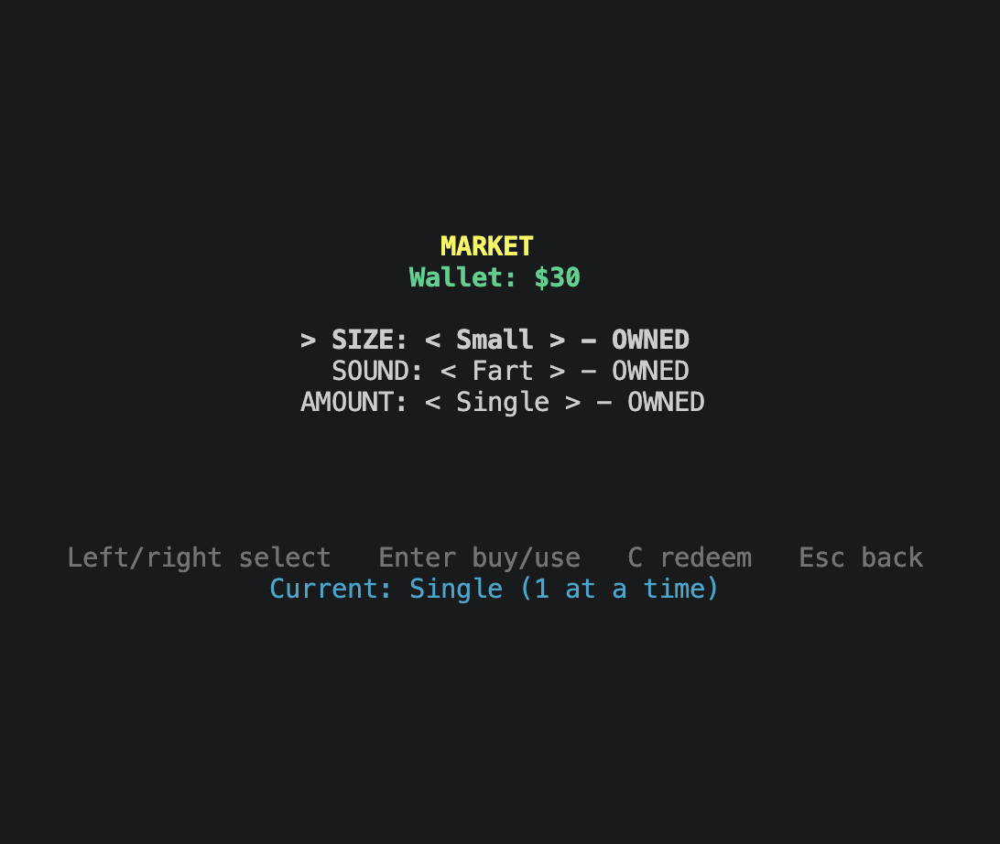

<p align="center">
  
</p>

<h1 align="center">PIGEON</h1>

<p align="center">
  <strong>Terminal arcade. Questionable aerial tactics.</strong><br />
  A real-time ASCII game built with Python, <code>curses</code>, and Pygame—with local progression and one-use money codes.
</p>

<p align="center">
  
  
  
  
  
  
</p>

---

## What is PIGEON?

PIGEON is a chaotic terminal arcade game about flying a pigeon over an ASCII city, building a wallet, and dodging the rocks that come back your way. The entire scene is drawn with terminal characters: no graphical game window required.

Choose a payload, tune your drop mode, buy upgrades, bring a flock, hunt The Mayor, and chase a better score. The latest build also includes a local admin tool for generating single-use money codes.

> **The pitch:** old-school terminal visuals, arcade pacing, a suspiciously detailed upgrade economy, and a boss called **The Mayor**.

## Screenshots

<p align="center">
  
</p>

<p align="center">
  
</p>

<p align="center">
  
</p>

<sub>These screenshots show the visual style from an earlier build. The current market also includes upgrades, Respect+ rewards, and family options; the menu includes the game-mode switch.</sub>

## Features

### The run

- **Two game modes:** play a 120-second round or switch to **Endless** and keep going until you run out of health.
- **Four-direction flight:** move with the arrow keys or WASD while pedestrians move across the city.
- **Payload choices:** Small, Medium, Large, and MEGA payloads have different ammo costs and ASCII visuals. Pedestrian scoring is determined by target type and proximity—not payload size.
- **Crowd proximity bonus:** hits made near the pigeon are worth double points.
- **Three pedestrian types:** normal, chunky, and VIP. VIPs are worth three times the base hit score.
- **Retaliation:** hit pedestrians can throw rocks back. Rocks can damage health, reduce score, and temporarily prevent dropping another payload.
- **Escalating difficulty:** score thresholds bring faster pressure, larger rock salvos, umbrellas, and eventually a boss fight.
- **The Mayor boss fight:** deal enough damage to defeat the Mayor for a **500-point bonus** and **$250**.

### Progression and customization

- **Four payload sizes** and **four drop modes**: Single, Double, Triple, and Shower.
- **Three sound-effect choices**, plus menu, gameplay, and family-scene music.
- **Four purchasable upgrades:** Shield, Rapid-fire Laxative, Faster Pigeon Movement, and Faster Reload. Only one upgrade can be equipped at a time.
- **Family options:** unlock a companion setup. Depending on the option, the pigeon flies with a partner or a small family—including a baby bird—and launches payloads from multiple birds.
- **Respect+ rewards:** chain hits on distinct pedestrians in a short combo window to earn Respect+, then spend it on a random eligible unlock.
- **Two code systems:** built-in codes unlock items for an in-game fee; administrator-generated money codes grant a chosen wallet amount and can be redeemed once.
- **Local admin utility:** generate unique 12-character money codes from the command line after providing the admin code.
- **Persistent progress:** best score, wallet, unlocks, modes, upgrades, family choice, and related progression are saved locally.
- **Clear User Data:** reset local progress and wallet after confirming the action.

## Get it running

### Requirements

- Python **3.9 or newer recommended**
- A terminal that supports `curses` and color output (color support can fall back if unavailable)
- Pygame for audio
- The three required music files listed under [Audio assets](#audio-assets)
- A terminal at least **70 columns × 20 rows**. Bigger is better for the city view.

### 1. Install dependencies

**macOS / Linux**

`curses` is normally included with Python on these systems. Install Pygame:

```bash
python3 -m pip install pygame
```

**Windows**

Install `windows-curses` and Pygame:

```powershell
py -m pip install windows-curses pygame
```

### 2. Arrange the files

Keep `defecation.py` (or your chosen script filename) and the `audio/` directory together. The game loads audio relative to the script location.

```text
pigeon/
├── defecation.py
├── audio/
│   ├── fart.mp3
│   ├── fart1.mp3
│   ├── fart2.mp3
│   ├── Star Wars Main Theme Cover (Handfarts).mp3
│   ├── 🌿 Nature Soundscape Relaxing Bird Songs for Study & Meditation 10 Min Mix 🎶.mp3
│   └── Romantic music sound effect.mp3
└── README.md
```

The screenshot directory in this repository is only for README images; it is not required to run the game. Audio tracks are not included in the README screenshot bundle.

### 3. Launch

From the project directory:

```bash
python defecation.py
```

Use `python3 defecation.py` or `py defecation.py` if that is how Python is installed on your system. These examples use the filename shown in the current code; substitute your actual filename if you renamed the script.

## How to play

### In-game controls

| Key | Action |
|---|---|
| `←` / `A` | Fly left |
| `→` / `D` | Fly right |
| `↑` / `W` | Fly up |
| `↓` / `S` | Fly down |
| `Space` | Drop payload |
| `Q` or `Esc` | Leave the run and return to the menu |

The timer begins on the first successful drop in Timed mode, so you can reposition before starting the clock. **Endless** mode has no countdown, but your health still matters.

### Main-menu controls

| Key | Action |
|---|---|
| `↑` / `K`, `↓` / `J` | Move the selection |
| `Enter` or `1`–`6` | Choose a menu item |
| `←` / `→` while **Audio** is selected | Lower / raise menu music volume |
| `Enter` while **Audio** is selected | Mute / unmute menu music |
| `←` / `→` or `Enter` while **Mode** is selected | Switch Timed / Endless |
| `Q` or `Esc` | Exit the menu loop |

### Market controls

| Key | Action |
|---|---|
| `↑` / `K`, `↓` / `J` | Select a market category |
| `←` / `→` or `H` / `L` | Browse options in the selected category |
| `Enter` or `Space` | Buy, equip, use, or claim the selected item |
| `C` | Enter a redeem code |
| `Esc` or `Q` | Return to the menu |

The market has six rows: **Size**, **Sound**, **Amount**, **Upgrade**, **Respect+**, and **Family**. The Respect+ row claims a random eligible reward; family options play a short animated scene when selected or unlocked. The Family row also contains a **Divorce** action, which clears the active family, keeps previously unlocked family options, and reduces the saved best score by about half.

In the code-entry screen, type a code and press `Enter` to redeem it. Use `Backspace` to edit or `Esc` to cancel.

## Game systems

### Difficulty and the Mayor

The difficulty tier is driven by score:

| Score | Level |
|---:|---|
| 0–49 | EASY |
| 50–149 | MEDIUM |
| 150–250 | HARDCORE |
| 251+ | U ARE FUCKED — the Mayor arrives |

As score climbs, pedestrians move faster and rock attacks become more intense. At the highest tier, some pedestrians carry umbrellas that can block a payload. The Mayor moves across the street and fires aimed rocks. The boss has **12 HP**; a hit deals **1 / 3 / 5 / 7 damage** with Small / Medium / Large / MEGA respectively. Defeating it awards **+500 score** and **+$250**. The live difficulty tier escalates from score; a larger drop mode does not directly raise the underlying score-tier calculation.

### Payload sizes

| Size | ASCII glyph | Ammo cost per payload | Market price | Mayor damage per hit |
|---|---|---:|---:|---:|
| Small | `.` | 1 | Free | 1 |
| Medium | `o` | 2 | $2,200 | 3 |
| Large | `(@)` | 4 | $3,500 | 5 |
| MEGA | `(@@@)` | 8 | $6,000 | 7 |

**Scoring note:** all payload sizes use the same pedestrian-score base. A normal or chunky pedestrian is worth **10 points**; a VIP is worth **30 points**. Hits made near the pigeon are doubled. Payload size affects ammo consumption and damage to The Mayor, not the pedestrian base score.

### Drop modes

| Mode | Payloads per bird per press | Market price |
|---|---:|---:|
| Single | 1 | Free |
| Double | 2 | $1,500 |
| Triple | 3 | $2,500 |
| Shower | 5 | $5,000 |

Ammo use is based on **payload size × drop count × number of active birds**. Family options can therefore make a press more expensive in ammo, but also put more payloads in the air. The game begins with enough ammo for one full selected burst and reloads automatically.

### Sounds

| Sound | Market price |
|---|---:|
| Fart | Free |
| Fart 1 | $1,800 |
| Fart 2 | $2,600 |

### Upgrades

Only one upgrade can be equipped at a time. Buy an upgrade in the market, then select it again to equip or unequip it.

| Upgrade | Price | Effect |
|---|---:|---|
| Shield | $5,000 | Blocks the first **3 incoming rocks** in a run |
| Rapid-fire Laxative | $6,500 | Reduces the drop cooldown from 0.28s to 0.14s |
| Faster Pigeon Movement | $4,500 | Raises movement acceleration and speed cap |
| Faster Reload | $4,500 | Reduces reload time from 2.0s to 0.9s |

### Family options

Family options add companion birds to the flight. They also change the ammo cost because multiple birds drop payloads on each press.

| Option | Price | Birds | What changes |
|---|---:|---:|---|
| Impress a Partner | $10,000 | 3 | Partner plus a baby bird |
| Impress a Partner + Condoms | $15,000 | 2 | Partner; no baby bird |
| Lesbian Partners | $15,000 | 2 | Partner configuration with its own color treatment |
| Gay Partners | $15,000 | 2 | Partner configuration with its own color treatment |
| Divorce (action) | Free | 1 (solo after action) | Disables the active family and halves the saved best score, approximately |

These options are available regardless of the selected character-gender setting. The active family setup is saved, and you can switch between options you have unlocked from the market. Family birds share the player’s health pool: rocks can hit the player, partner, or baby. Having companions also reduces the number and frequency of rocks in a retaliation salvo and slows the Mayor’s firing cadence.

**Divorce** is a free market action, not a family configuration to equip. It disables the active companions, retains your unlocked family options, and removes `floor(best_score / 2)` points from the saved best score. Selecting an unlocked family option again restores a family setup.

### Cash and Respect+

- **Wallet cash:** reaching each new 30-point score milestone awards $5.
- **VIP hits:** VIP pedestrians multiply the payload's base score by 3.
- **Close-range hits:** hitting while near a pedestrian doubles that hit's score.
- **Rock hits:** an unblocked rock normally removes 10 HP and 10 score, and briefly locks payload drops.
- **Respect+:** hit at least 3 distinct pedestrians within a short combo window (about 0.45 seconds) to earn +1 Respect+. A five-hit combo gets the stronger announcement, but still awards +1 for that combo.
- **Random reward:** spend 1 Respect+ to unlock one random item you do not yet own. Eligible rewards include payload sizes, sounds, drop modes, and upgrades.

### Redeem codes

Enter a code from **Market → `C`**. A successful new redemption costs **$1,000** in-game. Codes are converted to uppercase and spaces are ignored.

| Code | Unlocks |
|---|---|
| `PIGEON-PLUS` | Medium payload + Fart 1 sound |
| `SQUELCH-ME` | Fart 2 sound |
| `BIG-ONE` | Large payload |
| `BOMBS-AWAY` | MEGA payload + Fart 2 sound |

Built-in codes grant only items that are not already unlocked. A new built-in code costs **$1,000**; invalid or already-redeemed built-in codes do not charge the wallet.

### Generate one-use money codes (admin)

The current script also supports generating local wallet codes from the command line. You need the administrator code configured for your own build. **Do not paste a real admin code into a public README, issue, screenshot, or commit.**

```bash
python defecation.py --generate 'ADMIN-CODE' 5000
```

The command validates the admin code and amount, then prints a unique 12-character code for the requested amount. For example, `5000` creates a code worth **$5,000**. The allowed amount is **$1–$1,000,000,000**. If the admin code contains shell-sensitive characters, keep it quoted; replace `defecation.py` with your script’s actual filename if necessary.

Redeem the generated code in-game through **Market → `C`**, just like a normal code. Unlike built-in unlock codes, a generated money code adds its full amount to the wallet and does **not** charge the $1,000 redemption fee. Each generated code can be redeemed only once. Copy the printed code when it is created—the raw code is not stored in the registry.

Generated codes are tracked in `~/.pigeon_generated_codes.json` on the machine/user profile that created them. **Sharing only the code string with another computer or operating-system user will not work** unless the matching registry is also transferred. This is a local, offline code registry, not an online code service; there is no expiry or server-side fraud protection. Anyone who can edit the local files or restore an older registry can tamper with this system.

## Saves and privacy

Progress and generated-code state are stored locally in your home directory:

- `~/.pigeon_save.json` — best score, unlocks, selected payload, sound, drop mode, upgrades, Respect+, game mode, family configuration, and related progression.
- `~/.pigeon_wallet.json` — wallet balance plus a SHA-256 consistency hash.
- `~/.pigeon_generated_codes.json` — hashes, amounts, and used/unused status for locally generated money codes.

There are no online accounts or server-side saves in the supplied code. The wallet hash is a basic consistency check, **not encryption or tamper-proof security**; anyone who can edit the local game files or save data can still change their local experience.

To reset your progress, choose **Clear User Data** in the main menu and press `Y` to confirm. This resets the wallet, best score, unlocks, upgrades, Respect+, family setup, and selected game mode. Any other key cancels the reset. The current reset function does **not** delete `~/.pigeon_generated_codes.json`, so the local generated-code registry remains in place.

## Audio assets

The current code expects these three music files inside `audio/` and checks for all three during startup. Filenames must match exactly, including spaces and emoji.

| File | Used for | Required? |
|---|---|---|
| `Star Wars Main Theme Cover (Handfarts).mp3` | Main-menu music | Yes |
| `🌿 Nature Soundscape Relaxing Bird Songs for Study & Meditation 10 Min Mix 🎶.mp3` | Gameplay music | Yes |
| `Romantic music sound effect.mp3` | Family animation scene | Yes |
| `fart.mp3` | Fart sound | Optional |
| `fart1.mp3` | Fart 1 sound | Optional |
| `fart2.mp3` | Fart 2 sound | Optional |

If a sound-effect file is missing, the game falls back to a terminal beep for that effect. Missing music files stop initialization with an error. Before publishing or distributing the project, confirm you have permission to redistribute each audio track. Replace tracks you are not licensed to share and update the filename constants in `defecation.py`.

## Developer notes

PIGEON currently lives in one Python file (`defecation.py` in the supplied command examples). Its sections are separated by purpose—save/codes, audio, drawing helpers, game entities, game loop, and menus—so it can be run without a package build step.

### Useful extension points

- **Game balance:** constants near the top of `defecation.py` tune round length, HP, movement, projectile physics, rock behavior, boss stats, and cooldowns. `PERSON_HIT_POINTS` controls pedestrian scoring in this version; the older `pts`/`hw` fields in `SIZES` are not currently applied by the pedestrian scoring/collision path.
- **Market inventory:** `SIZES`, `SOUNDS`, `POOP_MODES`, `UPGRADES`, and `FAMILY_OPTIONS` define the purchasable content; price dictionaries/constants define costs.
- **Pedestrian behavior:** `Person.KINDS` controls pedestrian archetypes, colors, movement ranges, and score multipliers.
- **Boss behavior:** the `Boss` class and `BOSS_*` constants govern The Mayor.
- **Progress validation:** `load_save()` normalizes save values and filters unlocks against the current item definitions. Update validation when introducing new saved items.
- **Built-in redeem codes:** `CODES` maps SHA-256 hashes to unlock IDs. The helper below prints the normalized hash for a code:

  ```bash
  python defecation.py --hash "YOUR-CODE"
  ```

  Add that hash and the intended unlock IDs to `CODES`. IDs follow patterns such as `size:large` and `sound:fart2`; ensure the item exists and save validation accepts it.
- **Generated money codes:** `generate_money_code()` uses `secrets` to create a unique 12-character code, while `GENERATED_CODES_PATH` stores only the code hash and the amount/used state. `redeem()` validates the registry and marks the code used. Keep in mind this is local-only state—not a secure, server-enforced economy.
- **Atomic persistence:** `write_json_atomic()` writes to a temporary file, flushes it, and replaces the destination with `os.replace()` to reduce the chance of a partially written save after interruption.

### Suggested test checklist

When changing progression or collision logic, test these paths independently:

- Timed mode starts its clock only after the first successful drop; Endless does not count down.
- A single hit does not count the same pedestrian twice toward a Respect+ combo; distinct hits inside the ~0.45-second window are counted, and the combo resets after a reward.
- Single, Double, Triple, and Shower use the expected amount of ammo with and without family companions.
- Buying, equipping, unequipping, and resetting each upgrade behaves consistently.
- Boss spawn threshold, boss hits, defeat reward, and umbrella blocks behave as intended.
- Respect+ is awarded for multi-target hits and cannot be spent when no eligible rewards remain.
- Clear User Data resets progress and wallet while cancelling leaves them untouched; verify that the generated-code registry intentionally remains.
- Generated money codes can be redeemed once, give the configured amount, and reject repeat redemptions. Test behavior if writing the wallet or generated-code registry fails.
- Missing optional sound effects fall back cleanly; missing required music files produce a useful error.

## Troubleshooting

**The game says the terminal is too small.**  
Resize the terminal to at least **70 × 20** characters. A wider terminal makes the city and HUD easier to read.

**Windows says `curses` is missing.**  
Run `py -m pip install windows-curses pygame`, then launch again.

**The game cannot find music.**  
Confirm all three required music files are inside `audio/` beside `defecation.py`. Check spelling, spaces, punctuation, and emoji. You can alternatively rename your files and update `MENU_MUSIC_FILE`, `BACKGROUND_MUSIC_FILE`, or `ROMANTIC_MUSIC_FILE` in the script.

**A generated money code says invalid or already used.**  
Redeem it under the same local user profile that generated it, and check that `~/.pigeon_generated_codes.json` still exists. A code string alone is not portable to another machine. Reusing a redeemed code is intentionally rejected.

**The admin code is rejected.**  
The `--generate` command needs the admin code matching the hash in the version you are running. Check your quoting and use the exact build-specific code; do not publish it.

**Audio fails to initialize.**  
Check that the system has an available audio output device and that Pygame can initialize its mixer.

**Colors are missing or the display is cramped.**  
Use a terminal emulator with color support and a larger window. The game attempts to fall back if terminal color support is unavailable.

## License

No license file was provided with the supplied project. Until a `LICENSE` file is added, do not assume that the code or bundled assets are available for reuse or redistribution. Choose a license and add its full text before inviting outside contributions.

---

<p align="center">
  <sub>Made for terminals. Best enjoyed with a little space, a working audio device, and absolutely no respect for city planning.</sub>
</p>
